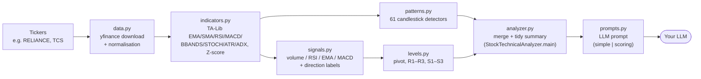

# EdgeQuantAI: Stock Technical Analyzer

[](https://github.com/maheshrajbhar90/EdgeQuantAI/actions/workflows/ci.yml)
[](https://www.python.org/)
[](LICENSE)
[](https://github.com/astral-sh/ruff)
[](https://mypy-lang.org/)

`StockTechnicalAnalyzer` turns a list of ticker symbols into a tidy technical
snapshot and an **LLM-ready analysis prompt**. It downloads OHLCV history with
[yfinance](https://github.com/ranaroussi/yfinance) and computes a standard
indicator set with [TA-Lib](https://ta-lib.github.io/ta-lib-python/). It also
detects 61 candlestick patterns, flags volume, RSI, EMA and MACD signals, and
derives classic pivot support and resistance levels. The defaults target Indian
equities on the NSE (`.NS`), but any Yahoo Finance market works. The same
engine powers the bundled Streamlit chat app (`main.py`).

## Why

Asking an LLM to "analyse RELIANCE" without data gives you vibes, not analysis.
This library does the deterministic part (fetching data, computing indicators,
detecting patterns and levels) in tested, reproducible code. The model receives
a structured, numeric snapshot and spends its effort on interpretation.

## Features

- **Data fetching:** adjusted OHLCV from yfinance, normalised to a naive
  Asia/Kolkata `Date` index.
- **Indicators:** EMA 5/9/26, SMA 50/200, volume SMA 20, RSI 14,
  MACD 12/26/9, Bollinger Bands 20, Stochastic, ATR 14, ADX 14, % change and a
  rolling volume Z-score.
- **Direction labels:** Bollinger, Stochastic, ATR and ADX states such as
  `Strong Bullish`, `Oversold Bearish` or `Strong Trend`.
- **Candlestick patterns:** 61 TA-Lib detectors (doji, engulfing, hammer,
  morning star and others).
- **Signals:** a bar is flagged when volume > VMA20, RSI ≥ 60, or EMA9/EMA26 or
  MACD crosses.
- **Support and resistance:** classic pivot point with R1–R3 and S1–S3.
- **LLM prompts:** a narrative prompt or a scoring-framework prompt built from
  the latest snapshot.
- **Fundamentals (optional):** `FundamentalAnalyser` computes basic ratios from
  yfinance statements and can call OpenAI.
- **Engineering:** typed (`py.typed`, mypy strict), tested offline (golden and
  differential tests, ≥ 95% coverage), with CI on Python 3.10–3.12.

## Architecture



| Module | Responsibility |
| --- | --- |
| `analyzer.py` | Public `StockTechnicalAnalyzer` class (thin orchestration; every step can be overridden in a subclass) |
| `data.py` | yfinance download and frame normalisation |
| `indicators.py` | Indicator columns and the volume Z-score |
| `patterns.py` | Candlestick pattern tagging |
| `signals.py` | Signal dict and direction classifiers |
| `levels.py` | Pivot and support/resistance maths |
| `prompts.py` | Prompt templates and the snapshot → prompt step |
| `fundamental.py` | `FundamentalAnalyser` (optional) |
| `constants.py` | Every parameter, threshold and column name in one place |

## Installation

Requires Python **3.10+**.

```bash
git clone https://github.com/maheshrajbhar90/EdgeQuantAI.git
cd EdgeQuantAI/EdgeQuantAI-main
pip install -e .            # library only
pip install -e ".[dev]"     # + pytest, ruff, mypy, pre-commit
```

### TA-Lib

`TA-Lib` (≥ 0.6) publishes **binary wheels with the C library bundled** for
Linux, macOS and Windows, so on most setups `pip install` just works. If pip
falls back to a source build, which shows up as compiler errors mentioning
`ta_libc` or `ta-lib/ta_defs.h`, install the C library first:

| Platform | Command |
| --- | --- |
| **Linux (Debian/Ubuntu)** | `curl -LO https://github.com/ta-lib/ta-lib/releases/download/v0.8.3/ta-lib_0.8.3_amd64.deb && sudo dpkg -i ta-lib_0.8.3_amd64.deb` |
| **macOS** | `brew install ta-lib` |
| **Windows** | Use the wheel (`pip install TA-Lib`); otherwise run the `ta-lib-0.8.3-windows-x86_64.msi` installer from the [TA-Lib releases](https://github.com/ta-lib/ta-lib/releases) |
| **Google Colab** | `!pip install TA-Lib` |

If TA-Lib still can't be imported, the library raises a `ModuleNotFoundError`
with these instructions.

## Quickstart

```python
from stock_technical_analyzer import StockTechnicalAnalyzer

analyzer = StockTechnicalAnalyzer(period="1y", interval="1d", exchange_suffix=".NS")

# Step by step for one ticker
ohlc = analyzer.fetch_ohlc("RELIANCE")  # pass the base symbol, not "RELIANCE.NS"
enriched = analyzer.add_indicators(ohlc)  # None if < 200 bars
signal = analyzer.generate_signal(enriched)  # None if no condition fires
print(signal)

# The whole pipeline for several tickers
summary = analyzer.main(["RELIANCE", "TCS", "INFY"])
print(summary[["Date", "Ticker", "Close", "RSI_Value", "EMA_Crossover", "Pattern"]])

# An LLM prompt for one of them
print(analyzer.build_prompt(summary, "RELIANCE"))
```

Or run the bundled script: `python examples/quickstart.py RELIANCE TCS INFY`.

<details>
<summary><b>Example output</b> (live data from 25 Nov 2026, truncated)</summary>

```text
Latest signal:
  Date: 2026-11-25 05:30:00
  Ticker: RELIANCE
  Close: 1372.0
  RSI_Value: 68.55760697986366
  RSI>=60: True
  MACD_Crossover:
  Volume_Spike: False
  BB_Direction: Bullish
  Stoch_Direction: Bearish
  ATR_Direction: Increasing
  ADX_Direction: Strong Trend
  EMA_Crossover:
  Pivot_point: 1374.4
  Resistance_1: 1391.8
  Support_1: 1354.6
  ...

                 Date    Ticker   Close  RSI_Value EMA_Crossover       Pattern
0 2026-11-25 05:30:00  RELIANCE  1372.0      68.56                         NaN
1 2026-11-25 05:30:00       TCS  2505.9      61.61                spinning_top

You are an expert Technical Analyst specializing in stock chart analysis for Indian equities.

   Analyze the stock **RELIANCE** using the technical indicators provided below.
   ...
```

INFY is missing from the table because it had no signal on its last bar, and
daily dates show `05:30`. Both are documented in
[KNOWN_ISSUES.md](KNOWN_ISSUES.md) (B2 and A2).
</details>

### Logging

The library logs through `logging` under the `stock_technical_analyzer`
namespace and configures no handlers. To see why a ticker was skipped:

```python
import logging

logging.basicConfig(level=logging.INFO)
```

### Backwards compatibility

Older import paths keep working and resolve to the same classes:

```python
from EdgeQuantAI import StockTechnicalAnalyzer  # original package name
from stock_analyzer import StockTechnicalAnalyzer  # name used in earlier docs
```

## API reference

### `StockTechnicalAnalyzer(period="5y", interval="1d", exchange_suffix=".NS", fmp_api_key=None, openai_key=None)`

| Method | Returns | Description |
| --- | --- | --- |
| `fetch_ohlc(ticker)` | `DataFrame \| None` | Download OHLCV for `ticker + exchange_suffix`. `None` if Yahoo returns nothing. |
| `add_indicators(ohlc)` | `DataFrame \| None` | Copy of `ohlc` with 22 indicator and direction columns. `None` if empty or < 200 rows. |
| `generate_signal(data)` | `dict \| None` | Latest-bar metrics (30 keys, incl. pivots) if volume, RSI, EMA-cross or MACD-cross fires, else `None`. |
| `identify_candlestick_patterns(ohlc_df)` | `DataFrame` | Adds `Pattern`/`Code` **in place** and returns the same frame. |
| `support_resistance_level(ohlc_day)` | `tuple[float, ...]` | `(pivot, r1, r2, r3, s1, s2, s3)` from the last row, rounded to 2 dp. |
| `z_score(df, window=20)` | `DataFrame` | Copy with `vol_mean`, `vol_std`, `vol_zscore`. |
| `bb_direction(row)` | `str` | `Neutral` / `Strong Bullish` / `Bullish` / `Bearish` / `Strong Bearish`. |
| `stoch_direction(row)` | `str` | `Neutral` / `Overbought Bullish` / `Bullish` / `Bearish` / `Oversold Bearish`. |
| `adx_direction(val)` | `str` | `Neutral` / `Strong Trend` (ADX > 25) / `Weak Trend`. |
| `get_latest_candlestick_patterns(symbols, periods=None, interval=None)` | `DataFrame \| None` | Per-ticker pipeline; merges each signal with the latest bar's pattern. Skips failing tickers (logged). |
| `main(ticker)` | `DataFrame \| None` | The full pipeline for a list of tickers: the summary table in a fixed 32-column order, rounded to 2 dp. |
| `get_tech_data_for_ticker(df, ticker)` | `dict` | Last row for `ticker` as a dict. Raises `ValueError` if absent. |
| `generate_technical_prompt(ticker, tech_data, mode="simple")` | `str` | LLM prompt; `mode="scoring"` selects the scoring framework. |
| `build_prompt(df, ticker)` | `str` | `get_tech_data_for_ticker` + `generate_technical_prompt`. |

### `FundamentalAnalyser(fmp_api_key=None, openai_key=None, exchange_suffix=".NS")`

| Method | Returns | Description |
| --- | --- | --- |
| `analyze(symbol, use_llm=False)` | `dict` | `symbol`, `metrics`, `fmp_ratios`, `prompt`, `llm_analysis`. |
| `fetch_yf_financials(symbol)` | `dict` | yfinance statements and `info`. |
| `compute_ratios(fin)` | `dict` | Net income, revenue, EBIT, equity, debt, FCF, ROE, ROCE, P/E, P/B and more. |
| `fetch_fmp_ratios(symbol)` | `list \| None` | Financial Modeling Prep ratios (needs `fmp_api_key`). |
| `build_prompt(symbol, metrics)` | `str` | Fundamental-analysis prompt. |
| `call_llm(prompt, model="gpt-4.1-nano", max_tokens=1500)` | `str \| None` | OpenAI completion (needs `openai_key`). |
| `safe_div(a, b)` *(static)* | `Any` | `a / b`, or `None` on a zero/`None` denominator or a failed division. |

## Streamlit app

```bash
pip install -r requirements.txt
echo '{"API_KEY": "<your Hugging Face token>"}' > config.json   # or use st.secrets
streamlit run main.py
```

Type a symbol such as `INFY` and the app builds the technical prompt and sends
it to `meta-llama/Llama-3.1-8B-Instruct` via the Hugging Face Inference API.

## Development

```bash
pip install -e ".[dev]"
pre-commit install            # run from the repository root

pytest --cov                  # tests + coverage (offline, ~3 s)
ruff check . && ruff format --check .
mypy                          # strict mode, configured in pyproject.toml
```

The test suite never touches the network: yfinance, `requests` and OpenAI are
mocked, and price data comes from a seeded synthetic fixture
(`tests/fixtures/ohlcv.csv`). It has three layers:

| Layer | File(s) | Purpose |
| --- | --- | --- |
| Golden (characterization) | `test_golden_*.py`, `tests/golden/` | Snapshots generated from the **pre-refactor** code; pin every public output. |
| Differential | `test_differential.py`, `tests/legacy/` | Runs a frozen copy of the original code side by side and asserts **exact** equality (dtypes, column order, types, exceptions). |
| Unit | `test_modules.py` + doctests | Internals, logging, compatibility shims, TA-Lib error message. |

If you intentionally change behaviour, regenerate snapshots with
`UPDATE_GOLDEN=1 pytest` and explain the change in `CHANGELOG.md`. See
[CONTRIBUTING.md](CONTRIBUTING.md).

## Roadmap

- Fix the items in [KNOWN_ISSUES.md](KNOWN_ISSUES.md), each in its own
  behaviour-changing PR (ticker suffix handling, IST date shift and the global
  warnings filter first).
- Move the project to the repository root.
- Add a ticker-comparison mode (the Streamlit app already detects multiple
  symbols).
- Make indicator parameters configurable per instance.
- Run the pipeline in parallel for large watch-lists.
- Publish to PyPI.

## Disclaimer

This project is for **educational and research purposes only**. It is **not
financial advice**. Technical indicators and LLM output can be wrong; do your own
research and consult a licensed advisor before making investment decisions.
Market data comes from Yahoo Finance via yfinance and is subject to Yahoo's
terms of use.

## License

[MIT](LICENSE) © Mahesh Kumar
